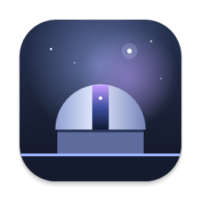
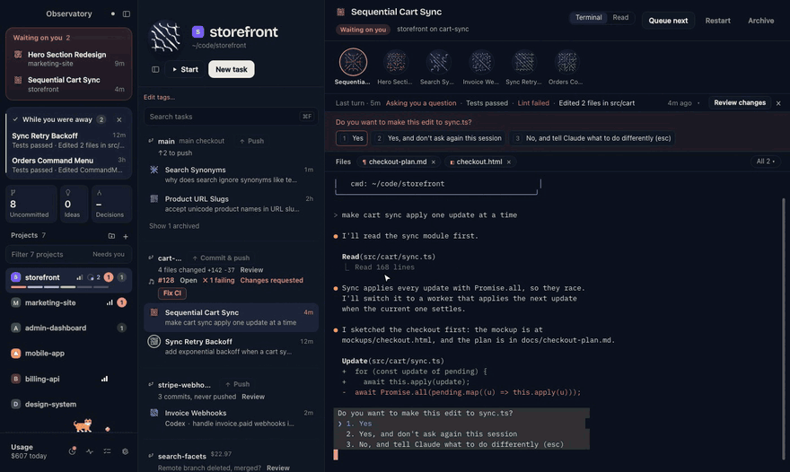
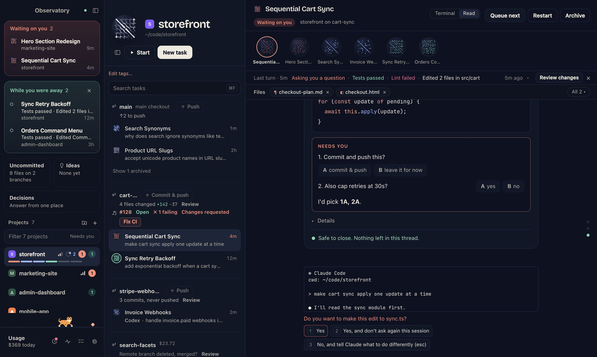
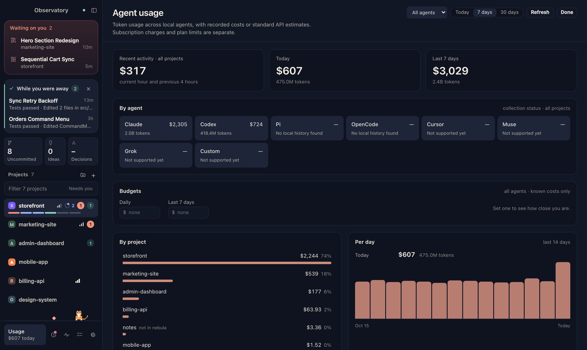
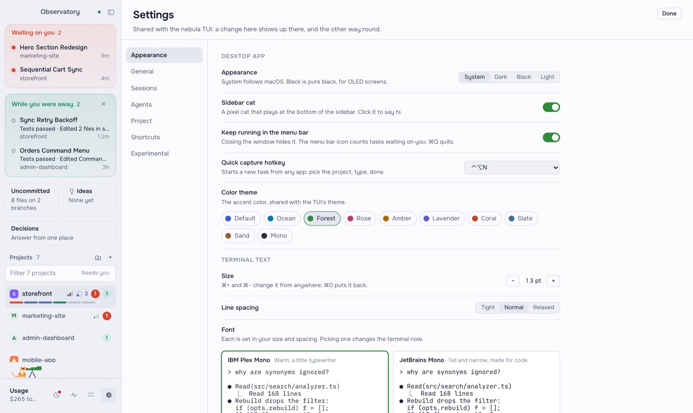
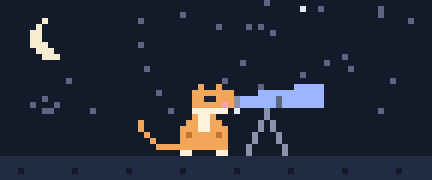

<p align="center">
  
</p>

<h1 align="center">Observatory</h1>

<p align="center">
  A macOS desktop client for <a href="https://github.com/AgentSystemLabs/nebula">nebula</a>, the
  daemon that runs your coding agents across a project's git worktrees.
</p>

<p align="center">
  
</p>

Run Claude Code, Codex and other agent CLIs in as many projects and branches as you like, and see
only the ones that need you. Each thread gets a sand plate: a Chladni figure its work moves, so you
can tell at a glance which agents are busy, which are waiting on you and which have settled. Observatory talks to the same daemon as the `nebula` TUI, so both can
be open at once on the same sessions. Close either one and your agents keep running.

## Install

**[Download Observatory](https://github.com/yobazy/observatory/releases/latest/download/Observatory.dmg)**
(macOS, Apple Silicon and Intel), open it, and drag the app into Applications.

The first time you open it, it installs [nebula](https://github.com/AgentSystemLabs/nebula) for you,
at the exact version the app is built for, and starts it. You'll also want an agent CLI for nebula
to run, such as [Claude Code](https://code.claude.com/docs/en/setup).

After that it keeps itself up to date: a new version downloads in the background, and **Restart to
update** appears at the bottom of the sidebar. Your agents keep running while it restarts.
Click **What's new** beside it for the release notes. Settings → General shows the version you're
on and can check right away.

If you upgrade nebula past the version the app was built for, the start screen says so and offers
to start a nebula that still speaks this app's protocol, or to update nebula to match.

### Or build it yourself

One command installs the build tools it needs, nebula, and the app:

```sh
curl -fsSL https://raw.githubusercontent.com/yobazy/observatory/main/scripts/setup.sh | bash
```

Or from a clone: `./scripts/setup.sh`. It checks for Xcode's command line tools, Node 20+ and
Rust (offering to install what's missing), installs nebula at the pinned version (asking before it
replaces a different one), builds the app into `/Applications`, and opens it. `--check` shows what
it would do without changing anything, and `--help` lists the other options.

## What it does

**Sessions**


- **Projects sidebar**: filter it with `⌘P` and jump with `⌘1`–`⌘9`. Each project shows one bar
  segment per session, a spinner with the number of tasks in progress, and badges for tasks waiting
  on you and finished ones you haven't read. Your last few projects sit above the list under
  **Recent**. `⌘O` adds a project from a folder, with the TUI's checks (already a project, missing
  folder, not a git repo).
- **Waiting on you**: every session blocked on a permission prompt or a question, across all
  projects. `⌘J` cycles through them, and you get a macOS notification and a dock badge. A
  permission prompt's choices show as buttons above the terminal, so you can answer without
  reaching for the keyboard. **Decisions** (`⌥⌘J`) lists every open question in one place.
- **While you were away**: turns that finished while you weren't looking, with a line on what
  each did (tests passed, files edited). A finished task stays under Follow up until you reply,
  archive it or tick it off.
- **Sand plates**: each thread's status dot is a Chladni plate. Every prompt or tool step moves
  the sand to a new figure, so working threads keep shifting, waiting ones hold and pulse, and
  finished ones settle. A project's plate is its emblem in the header.
- **Live strip**: a row of plates under the pane header, one per working, waiting or unread
  thread across all projects. Click one to open it.
- **Worktree bands**: sessions grouped by branch, with the ones that need you first. Switching
  projects brings back the session you last had open there.
- **Turn summary**: a line above each terminal says what the latest turn did, for Claude Code and
  Codex threads. Open it for the commands it ran, folded into one line.
- **Terminal**: attach to any agent or shell. Shift+Enter inserts a newline in Claude Code.
  `⌘↑`/`⌘↓` page through the scrollback and `⇧⌘↑`/`⇧⌘↓` jump to either end; hold `⌥` while
  scrolling to go five times faster. Scrolled up, a **Jump to latest** button takes you back.
  Web addresses and file paths it prints are links. `⌘G` shows up to four terminals in a grid.
- **Right-click a task** for the TUI's menu: follow-up prompt, restart, duplicate, rename,
  archive, run or stop the dev server, open the worktree, delete. Observatory adds pin to top,
  priority, tags, a color, and **Move to project…**, which starts a new thread in another project
  with a brief of this one.
- **Hide either column** with `⌘B` (projects) and `⌥⌘B` (tasks), or drag them to resize.
- **New task** (`⌘N`): on an existing branch or a new worktree (the branch name is suggested from
  the task), with your choice of agent and preset. Pick several agents to try the same task on
  separate worktrees, then compare the attempts side by side and keep the best.
- **`⌘K`** opens a palette of every action, task and project, with your recent threads first.
  `⌘[` goes back to the thread you had open before this one.
- **Moved a project's folder?** Its row says the folder is missing, and **Locate…** points the
  project at the new place, carrying its icon, color, settings and Claude Code history with it.
  Right-click a project to **Remove from list**; nothing on disk is touched.

**Reading a thread**



- **Read** beside **Terminal** shows a Claude Code or Codex thread as a conversation, with a reply
  box below it. It opens at what's new since you last looked, and earlier turns fold away. `⌘F`
  finds in the thread, and an outline down the side has one dot per turn.
- **Replies written as cards** (a bold headline, status dots, a **Needs you** list, folded
  **Details**) read as cards. Lettered options are buttons that build `1 A, 2 B` in the reply box,
  and when the agent recommends an answer, **Tab** takes it. Decisions you haven't answered wait
  in a tray above the box.
- **Select part of a reply** and choose **Reply about this** to quote it. A file named in a reply
  opens in the preview, a PR number links to the PR, and an edit step shows its diff.
- **Run** beside a shell command in a reply sends it to the thread as `! <command>`, so it runs
  there and its output lands in the thread. A permission prompt shows the command it's asking
  about above its choices.
- **Tables** wrap at whole words, scroll sideways when they're wide, and have columns you can drag
  to resize.
- **Close thread**: when a reply ends with "Safe to close", one click archives the thread and takes
  you back to the one before, with **Undo**. "Keep open" or "Don't close" shows its reason in the
  header instead.
- **Your reply shows at once** as a bubble at the end of the thread, with **Sending…**, or
  **Waking…** while a sleeping thread starts up to take it.
- **Queue next** holds a message until the agent's turn ends. You can edit it or take it back
  before it goes.

**Previews**

- **Paths in a terminal light up.** Rest the pointer on one an agent printed (an HTML mockup, a
  Markdown doc, an image, a PDF, a video) for a preview card, and click to open it. Paths are
  absolute, `~/`, or relative to the task's checkout, and a long path the agent's CLI broke across
  lines still counts, spaces and all.
- **The preview opens over the terminal, or beside it** (Settings › General › Previews). HTML
  mockups render with their own CSS, images and scripts, at phone, tablet or full width; Markdown
  reads as a document. When the agent edits the file, the preview updates on its own. **Open**
  sends any file to its own app, your editor or Finder.
- **`nebula open <file>`** from an agent opens the file there too.
- **Comment on a mockup.** Click **Comment** (or press `C`) in an HTML or Markdown preview, click
  what should change, and say how. Each comment gets a numbered pin. **Send** hands them all to the
  agent that made the file as one prompt (queued if it's mid-turn), or to another task in the
  project. Sent pins turn grey, so when the preview reloads you can check each one was handled.
- **Files** above each task's terminal lists the mockups, docs and images it has shown, newest
  first. Hover a chip for the preview card, click to open it.
- Previews only reach files you open, and pages run sandboxed, away from the app.

**Git and shipping**

- Each band shows where its branch stands: files changed with lines added and removed, commits to
  push, a branch that was never pushed, commits behind, merge conflicts, and a remote branch that's
  been deleted.
- **Commit & push**, **Push** or **Resolve** hands the job to an idle agent on that branch, or
  starts one. It waits while an agent there is still mid-turn, so nothing gets committed half-done.
- **Pull requests** (through `gh`): each branch shows its PR's state, checks and review. **Open PR**,
  **Fix CI** (hands the failing checks to an agent), **Merge** once it's green, then **Clean up**
  removes the checkout.
- **Review changes** opens a branch's diff, or the uncommitted work a turn left. Comment on lines
  and send the comments back to the thread that made them. **Uncommitted** in the sidebar lists
  uncommitted work across every project.

**Running the project**

- **Start** runs the project's run command (the Project setting, or `run` in `.nebula.json`) in the
  worktree's run terminal. Once the dev server prints its address, the band shows it as a link.
- No run command yet? Type one, or ask an agent to work it out and write `.nebula.json`.
- **An agent started the server itself?** The address it printed shows above its terminal and as
  the port on its row, so it's one click away. Running more than one? **+N** lists them all. Only
  addresses that answer show, and one turns grey once its server stops.
- **Activity** (`⌥⌘U`) shows what's running in each project: processes, CPU, memory and the ports
  they serve, with a tag on dev servers and test browsers left running. Stop or force quit one from
  there.
- **Automations** (from the sidebar footer) lists your launchd jobs with their last run, schedule,
  and whether they're stale or failing. Run one now or open its log. A job that starts failing
  puts up a banner, except in quiet hours.

**Organizing**

- **Folders, names and tags for projects**, from a project's right-click menu. Folders fold away
  and still show what inside needs you. Tags filter the list, and so does typing `#tag`.
- **Priority** (urgent, high, low) on threads and projects moves them up or down their list. On a
  selected thread, `P` steps through them.
- **Thread tags**: chips above a project's list show one tag's threads. **Tag untagged** asks an
  agent CLI (`claude -p --model haiku` by default) to tag the rest from the project's own tags.
- **Ideas**: `⌘I` writes an idea down without leaving what you're doing, filed under a project or
  Unsorted, with a priority and a deadline if you want. `⇧⌘I` shows them all, ready to start as a
  task.
- **Quick capture**: a hotkey that works from any app (`⌃⌥N` by default) starts a task, saves an
  idea, or pastes a list into Dispatch. Observatory can keep running in the menu bar when you
  close its window, with a count of what's waiting on you.
- **Dispatch** (`⇧⌘N`): paste a to-do list, and one headless call to your agent CLI routes each
  item to a project. Edit the plan, then dispatch it a few tasks at a time, and follow them on one
  board.
- **Hand a task to another project**: an agent can open
  `observatory://new-task?project=…&prompt=…` to fill in New task there. Nothing starts until you
  click Start. Settings → Agents has the line to paste into your `CLAUDE.md` or `AGENTS.md`.

**Agent usage** (`⌘U`)



Usage across Claude Code, Codex, Pi, and OpenCode: today, 7 or 30 days, by agent, project,
task, and day. Click an agent to filter or a task to open it. The sidebar shows today's known
cost across agents. Recent activity covers the current hour and the previous four hours;
it is not a provider's quota window. Set a daily or weekly budget to see how close you are.

The collectors read local histories without modifying them:

- Claude Code: `~/.claude/projects` (or `CLAUDE_CONFIG_DIR/projects`).
- Codex: `~/.codex/sessions` and `archived_sessions` (or under `CODEX_HOME`).
- Pi: `~/.pi/agent/sessions` (or `PI_CODING_AGENT_DIR/sessions`).
- OpenCode: `~/.local/share/opencode/opencode.db` (or under `XDG_DATA_HOME`), read-only.
  Both `message` and `session_message` database schemas are supported; legacy JSON storage is not.

Pi and OpenCode supply recorded costs; other costs use known standard model rates. Unknown
models still count toward token totals and show as unpriced, rather than receiving a guessed
rate. Budgets use known costs only. These estimates are not subscription charges or plan caps.
Service tiers, long-context premiums, and other provider charges can differ.

Cursor, Muse, Grok, and custom-agent usage is not collected yet. Their status is explicitly
shown in the window, alongside missing histories and read errors, so missing usage isn't
presented as measured zero usage.

**Settings** (`⌘,`)



Night-blue surfaces with ivory text by default, and the same design by day in Light (ivory pages,
ink-blue text). Every tab of the TUI's settings, written to the same files the same way, so a change in either
app shows up in the other. Rows that only affect the TUI's look are tagged. The color theme is
shared with the TUI; System, Dark, Black and Light are for the desktop app, and the terminal
follows them. The terminal's font is picked by seeing each one set the same text, and `⌘+`/`⌘−`
size it from anywhere.

**Usage log** (Settings › General, off unless you turn it on): notes what you click, the views
and dialogs you open and how long they stay up, the ⌘ shortcuts you press and the errors you hit,
one JSON line each in `~/Library/Application Support/dev.bazil.observatory/usage-log.jsonl`. Never what you
type, and nothing is sent anywhere. It's there to show where the app gets in your way.

**Mark this moment** (`⇧⌘M`): noticed something off? This saves the last minute of those events,
what's on screen (the view, project, session and its status) and a screenshot of the window to a
folder under `moments/` beside the log, copies the folder's path, and takes a line on what you
saw. Paste the path wherever you're reporting it, or start a task from it: an agent fixes it in its
own worktree and opens a PR, and a second agent reviews and merges it. The minute is kept in
memory whether or not the log is on, and only written when you press it. The screenshot needs
Screen Recording allowed.

<p align="center">
  
</p>

**And** a pixel cat that plays at the bottom of the sidebar. It chases a
yarn ball, naps, watches the sky through its telescope, and sits up when an agent starts waiting
on you. While a thread works, a second cat keeps it company on the Read view's working line: it
types at a laptop while the agent edits, reads a book while it reads, paces while a command runs,
looks through its telescope during a web search, sweats when a command fails, and dozes if one step
takes two minutes. Click either cat to say hi, or turn them off in Settings.

## Building from source

```sh
npm install
npm run tauri dev      # against your real nebula daemon
npm run tauri build    # .app in src-tauri/target/release/bundle/macos
```

The app connects to the daemon the TUI uses (`nebula` starts it; the app offers to as well). To
work on it without touching your sessions, use the sandbox below instead.

## Version pinning

The daemon only accepts clients built with its exact `PROTOCOL_VERSION`. `nebula-core` is pinned
by tag in `src-tauri/Cargo.toml`:

```toml
nebula-core = { git = "https://github.com/AgentSystemLabs/nebula", tag = "v0.45.0" }
```

After `nebula upgrade`, bump the tag and rebuild (`./scripts/setup.sh` picks up the new tag and
checks your nebula matches it). If the protocol changed, `src/nebula/types.ts`
may need the same change; the e2e check below catches drift. On a mismatch the app shows a
"doesn't match" screen rather than misbehaving.

## Developing without touching your sessions

`scripts/sandbox.sh` runs a throwaway daemon with its own socket, database and settings, two demo
repos, and a fake agent CLI (`scripts/fake-agent.sh`) that fires nebula's status hooks instead of
calling a model. In a fake agent, type `ask …` to make it wait on you.

```sh
scripts/sandbox.sh app    # the app against the sandbox
scripts/sandbox.sh up     # the same in the background, for scripts/drive
scripts/sandbox.sh down   # stop what `up` started
scripts/sandbox.sh e2e    # protocol check: worktree, agent, attach, input, statuses
scripts/sandbox.sh stop
scripts/sandbox.sh automations        # a throwaway launchd job for the Automations view
scripts/sandbox.sh automations-clean  # remove it
```

`scripts/drive` works the sandbox app from a shell, so an agent can check a change without you
clicking for it: `state`, `view`, `select`, `click`, `type`, `key`, `shot` and more (run it with
`-h`). `scripts/drive replay <moment dir>` puts a marked moment's view and thread back on screen.

`npm run dev` on its own serves a browser preview with demo data and a canned terminal. It's
handy for styling, and needs no daemon. The screenshots above are from it:
`node scripts/screenshots.mjs` retakes them, the demo GIF and the release cover (`stills` skips
the GIF).

## Layout

- `src-tauri/src/daemon.rs`: the socket connection. It forwards daemon events to the webview,
  with terminal output sent separately as base64.
- `src-tauri/src/git.rs`: a checkout's git state (the daemon doesn't report it).
- `src-tauri/src/usage.rs` and `usage_sources.rs`: collect local agent usage into hourly buckets.
- `src/nebula/usageData.ts`: pricing and attribution; `npm run test:usage` runs its tests (Node 22+).
- `src-tauri/src/settings.rs`: writes nebula's settings the way the TUI does.
- `src-tauri/src/control.rs` and `src/nebula/control.ts`: the socket `scripts/drive` talks to, in
  dev builds.
- `src/nebula/`: typed protocol mirror, store, client (request/Ack routing), notifications, and
  the git, usage, runs, settings and theme logic.
- `src/components/`: sidebar, sessions column, terminal pane, reader, dialogs, usage and settings
  views, and the cat (`petBrain.ts` is its behavior, separate from the drawing).
- `tests/`: Node tests for the logic in `src/nebula/`; `npm test` runs them.
- `src-tauri/icons/app-icon.svg`: the icon's source. Regenerate the set with
  `npx tauri icon src-tauri/icons/app-icon.svg`.
- `scripts/dmg-background.py`: draws the DMG window's background; the layout is under
  `bundle.macOS.dmg` in `src-tauri/tauri.conf.json`.

## Releasing

Releases are signed with a Developer ID Application certificate and notarized by Apple, so they
open without the "Open Anyway" step. You need the certificate in your keychain (Xcode → Settings →
Accounts → Manage Certificates → + → Developer ID Application) and an app-specific password from
appleid.apple.com.

```sh
./scripts/release.sh --setup     # once: saves your Apple ID and app-specific password to the keychain
./scripts/release.sh             # universal build, signed, notarized, stapled and verified
./scripts/release.sh --publish   # the same, then gh release create v<version>
```

It writes `Observatory.dmg` at the repo root, the asset name the README's download link points at.
Bump the version in `src-tauri/tauri.conf.json`, `src-tauri/Cargo.toml` and `package.json` first.

Each release page leads with a download button, `docs/release/cover.jpg`, and
`docs/release/whats-new.md`, which is rewritten for every release (the script won't build while
it's unchanged since the last tag). Before each release, run `node scripts/screenshots.mjs` so
the cover, the README's screenshots and its demo show the app as it ships. The commit
subjects since the previous tag (version bumps left out) go underneath, and into `latest.json`,
where **What's new** reads them.

Each release also carries `Observatory.app.tar.gz`, signed with the updater key, and `latest.json`,
which installed copies check (`plugins.updater` in `tauri.conf.json`). The key is
`~/.tauri/observatory.key`, with its password in the login keychain under
`dev.bazil.observatory.updater`. Back up both: without them, installed copies can't be updated, and
a new key means everyone downloads the DMG again.

## License

[Apache 2.0](LICENSE)
